<p align="center">
  
</p>

<h1 align="center">Licensia</h1>

<p align="center">
  <strong>Cryptographic Software Licensing, Offline Activation &amp; Anti-Piracy Engine for Laravel 11 / PHP 8.2 (Ed25519 Signed License Keys)</strong>
</p>

<p align="center">
  <a href="https://josskixg.github.io/licensia/"></a>
  
  
  
  
</p>

---

## Live Interactive Operator Console

**Try the live Cryptographic Key Issuer & Offline Tamper Sandbox:**  
👉 **[https://josskixg.github.io/licensia/](https://josskixg.github.io/licensia/)**

- **Live Cryptographic Certificate Issuer:** Select tier (`Starter`, `Pro`, `Agency`), bind a domain/HWID, set expiration, and sign a `LIC-v1.<payload>.<signature>` certificate.
- **Interactive Tamper & Offline Verifier Sandbox:** Mutate a single byte of the Base64URL payload or change the runtime host assertion and watch the verifier immediately flag `TAMPERED_SIGNATURE` or `DOMAIN_MISMATCH` vs `VALID_CRYPTOGRAPHIC_SEAL`.
- **Dark / Light Vercel Geist Polarity:** Toggle between `#000000` / `#0a0a0a` dark mode and `#ffffff` / `#fafafa` light mode with `localStorage` persistence and `tabular-nums` telemetry.

---

## Why Ed25519 Offline Licensing Beats Simple Database Keys

Traditional licensing systems (`UUID` strings checked via HTTP `POST /verify`) fail when:
1. Buyers run software on air-gapped servers, local desktops, or restricted enterprise firewalls.
2. Pirates null the HTTP check or spoof a `{"valid": true}` JSON response via `/etc/hosts`.
3. Your licensing server experiences downtime, breaking every customer's production deployment.

**Licensia** solves this with native PHP 8.2 **`ext-sodium` Ed25519 asymmetric cryptography**:
- Your Laravel 11 licensing server holds the **64-byte Ed25519 secret key** (`sodium_crypto_sign_detached()`) and issues signed certificates.
- Client applications embed **only the 32-byte public key** (`sodium_crypto_sign_verify_detached()`).
- Even with full source code access, an attacker **cannot forge a license certificate, extend the expiration date, upgrade the tier, or change the bound domain hash** without the private key.

---

## Cryptographic Certificate Anatomy (`LIC-v1`)

```text
LIC-v1 . eyJ2ZXIiOjEsImxpZCI6ImxpY184ZjRlOWE... . X9kL2mP8qR4tV6wY0zB3nC5vM7xZ1aS4dF6gH8jK0l...
──────   ──────────────────────────────────────   ─────────────────────────────────────────────
Prefix        Base64URL Canonical JSON Claims            64-Byte Ed25519 Detached Signature
          {                                        sodium_crypto_sign_detached(
            "ver": 1,                                "LIC-v1.<payload_b64url>",
            "lid": "lic_8f4e9a1c6b2d",               $secretKey64Bytes
            "prd": "larasaas-commerce-v4",         )
            "cst": "cto@nusantara.dev",
            "bnd": "9c4a1e8f02b7d3c5a6e1f490",
            "env": "billing.nusantara.dev",
            "tir": "pro",
            "sts": 5,
            "iat": 1762646400,
            "exp": 1825804799
          }
```

| Claim | Field | Description |
| :--- | :--- | :--- |
| `ver` | Schema Version | Protocol version (`1`) |
| `lid` | License ID | Unique identifier (`lic_...`) |
| `prd` | Product Slug | Target product / plugin identifier |
| `cst` | Customer | Buyer email or organization ID |
| `bnd` | Environment Hash | 24-char SHA-256 fingerprint of normalized domain / HWID (`*` for wildcard) |
| `tir` | License Tier | `starter` (1 seat), `pro` (5 seats), `agency` (25 seats) |
| `sts` | Max Seats | Maximum concurrent domain/HWID activations permitted |
| `exp` | Expiration | UNIX UTC timestamp enforced offline |

---

## Repository Architecture

```text
licensia/
├── app/
│   ├── Http/Controllers/
│   │   └── LicenseServerController.php   # Issue, activate seat, verify heartbeat, revoke
│   └── Services/
│       └── LicenseCryptoService.php      # Native PHP 8.2 ext-sodium Ed25519 engine
├── assets/brand/                         # Audited SVG/PNG/ICO brand kit & webmanifest
├── config/
│   └── licensia.php                      # Ed25519 keypair, grace period & tier quotas
├── database/migrations/
│   └── 2026_11_09_000001_create_licensia_tables.php
├── routes/
│   └── api.php                           # /api/v1/licenses/* endpoints
├── tests/Unit/
│   └── LicenseCryptoTest.php             # Self-contained PHP 8.2 libsodium test suite
├── DESIGN.md                             # Vercel Geist Monochrome token spec
├── composer.json                         # josskixg/licensia package manifest
├── index.html                            # Interactive Command & Inspect Console
└── logo.svg                              # Geometric vector mark (100/100 svg_audit score)
```

---

## Quick Start & Laravel 11 Integration

### 1. Generate Your Publisher Ed25519 Keypair

```php
use App\Services\LicenseCryptoService;

$crypto = new LicenseCryptoService();
$keys = $crypto->generateKeyPair();

// Store in .env on your licensing server:
// LICENSIA_SECRET_KEY_HEX={$keys['secret_key_hex']}
// LICENSIA_PUBLIC_KEY_HEX={$keys['public_key_hex']}
```

### 2. Issue a Signed License Certificate (Server)

```php
$certificate = $crypto->issueCertificate([
    'product_id' => 'larasaas-commerce-v4',
    'customer'   => 'cto@nusantara.dev',
    'domain'     => 'billing.nusantara.dev',
    'tier'       => 'pro',
    'max_seats'  => 5,
    'expires_at' => strtotime('+1 year'),
], env('LICENSIA_SECRET_KEY_HEX'));
```

### 3. Verify Offline Inside Buyer Application (Client SDK)

```php
$result = $crypto->verifyCertificateOffline(
    certificate: $certificate,
    publicKeyHex: '8f4e9a1c6b2d08f1e5a3c7d9b4f201e6a8c4d2e0f9b7a5c3e1d8f6a4b2c03d7b',
    expectedDomainOrHwid: $_SERVER['HTTP_HOST'] ?? 'billing.nusantara.dev'
);

if (!$result['valid']) {
    abort(403, 'Licensia Seal Rejected: ' . $result['status'] . ' — ' . $result['reason']);
}
```

---

## Running the Cryptographic Test Suite

Verify keypair generation, detached Ed25519 signing, offline verification, single-byte tamper rejection, expiration enforcement, domain binding mismatch, and seat quota allocation:

```bash
php tests/Unit/LicenseCryptoTest.php
# PASS: All 6 Licensia Ed25519 cryptographic licensing & offline verification assertions succeeded.
```

---

## License

Released under the [MIT License](composer.json). Built with the **Vercel Geist Design System**.
